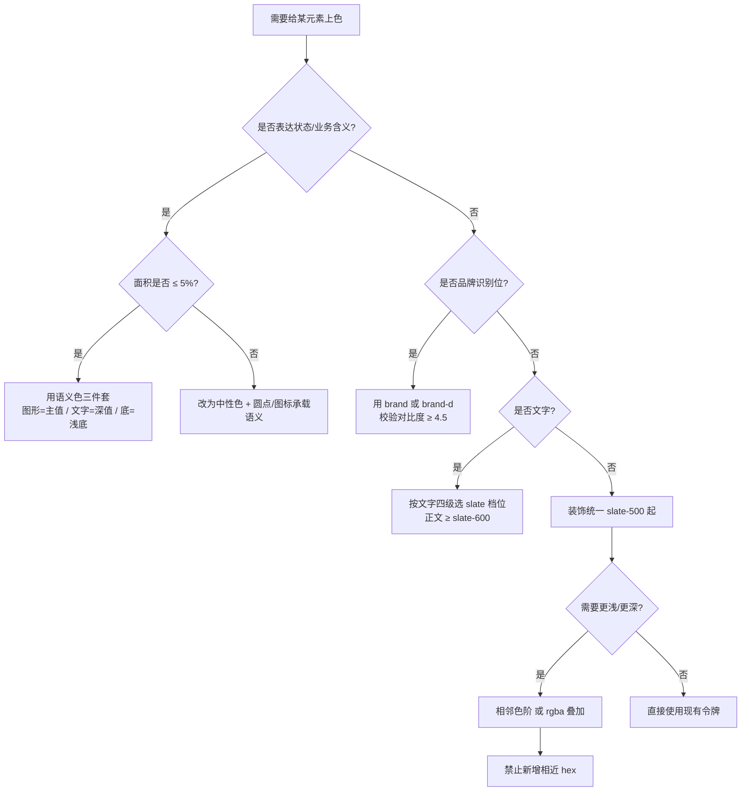

# 前端视觉格调设计规范（Slate 单色系）

> **版本** v1.0　|　**类型** 可复用设计规范（跨项目）
> **来源** 提炼自 CampusFix 项目 `CampusFix-色彩设计规范.md` 与 `CampusFix-界面配色说明.md`（v1.0，2026-11-06）
> **定位** 与业务无关的**通用视觉基调**规范。新项目可直接沿用色板与规则，仅替换品牌色与业务语义。
> **适用** 中后台管理系统、SaaS 控制台、数据看板等**信息密度高、以数据为主体**的界面。

---

## 0. 文档定位与使用方式

### 0.1 这套规范解决什么问题

多数后台界面"看起来乱"，根源不是缺设计，而是**装饰色与语义色职责混用**：

- 四张指标卡用红/橙/蓝/绿区分，颜色不承载任何含义，只是"好看"；
- 状态标签每种状态一种底色，一屏出现 6–8 种色块；
- 品牌色既做主按钮、又做警告、又做选中态，用户无法判断"哪个能动、哪个危险"。

本规范的核心主张只有一句：

> **装饰只用中性色，彩色只承载语义。视觉秩序靠明度、字重、面积建立，而不是色相。**

### 0.2 规范强度用语

| 用语 | 含义 | 违反后果 |
|---|---|---|
| **必须 / 禁止** | 硬性红线 | 视为不合规，评审阻断 |
| **应 / 不应** | 强烈建议 | 需书面说明理由方可例外 |
| **可 / 建议** | 可选优化 | 视场景取舍 |

### 0.3 使用方式

1. **设计阶段**：按 §3 取色、§5 查组件配方、§6 规避红线；
2. **开发阶段**：整段复制 §9.1 的 CSS 令牌，禁止组件内散落 hex；
3. **评审阶段**：用 §10 清单逐项打勾，任一项不通过即退回；
4. **排错阶段**：界面"花"时先查 §2.3 面积占比，再查 §7.2 对比度。

---

## 1. 设计原则

| # | 原则 | 说明 | 落地手段 |
|---|---|---|---|
| P1 | **单色系主导** | 页面 90% 以上面积由中性色阶构成，视觉秩序来自明度与字重，而非色相 | 装饰元素统一取 `--slate-*` |
| P2 | **语义靠小面积** | 状态色只用于 6–8px 圆点、16px 图标、小标签底色 | 彩色面积 ≤ 10% |
| P3 | **三层色板** | 中性色（结构）→ 语义色（含义）→ 品牌色（识别），三层职责不得混用 | 见 §2 |
| P4 | **对比度优先** | 任何"好看但看不清"的组合一律作废 | 正文 ≥ 4.5:1 |
| P5 | **不造新色** | 需要更浅/更深时，用 `rgba()` 叠加或相邻色阶，禁止随手新增相近 hex | 同色透明度配方 §4.1 |
| P6 | **不依赖颜色** | 状态须同时用文字/图形表达，保证色盲可辨 | 双通道编码 §7.5 |
| P7 | **层级用三手段** | 明度、字重、面积三者叠加，而非引入新色相区分优先级 | §6.3 |
| P8 | **深色区不超过视口 1/3** | 深色块是"重音"，过量则压迫感强、对比失衡 | §5.7 |

---

## 2. 色彩层级体系

### 2.1 三层结构

| 层级 | 职责 | 色板构成 | 建议面积占比 |
|---|---|---|---|
| **L1 中性色** | 背景、表面、边框、文字、图标、图表填充 | Slate 11 档 + 结构别名 | **≈ 90%** |
| **L2 语义色** | 成功 / 警告 / 严重 / 错误 / 信息 | 每色 **三件套**：主值 + 文字深值 + 浅底 | **≈ 8%** |
| **L3 品牌与辅助** | 品牌识别、图表点缀 | 品牌色 + 蓝/紫/青 | **≤ 2%** |

### 2.2 职责边界

| 层级 | 允许出现的位置 | **禁止**出现的位置 |
|---|---|---|
| L1 中性色 | 一切结构性与装饰性元素 | — |
| L2 语义色 | 圆点、图标、边框、进度条、小标签底 | 大面积铺底、装饰性图形、纯为美观的强调 |
| L3 品牌色 | Logo、负向操作确认、品牌识别位 | 主按钮、装饰渐变、普通强调文字 |

### 2.3 面积占比是排错工具

界面偏"花"时，先估算彩色面积。经验值：一旦彩色超过 **10%**，几乎必然出现视觉噪音、重点稀释、对比度失控。处理顺序：

1. 把装饰性彩色改为 `--slate-*`；
2. 把状态色收缩进圆点或图标；
3. 剩余彩色逐一确认是否在**编码数据类别或业务含义**（判断标准见 §5.9）。

---

## 3. 核心配色方案

### 3.0 三个"主"必须分清（易误读点）

原始文档中"主色"一词指代过三种不同对象，跨项目复用时必须区分，否则会出现"主按钮用 `--slate-500`、选中态用 `--slate-900`"这类错配：

| 概念 | 令牌 | 色值 | 职责 | 典型位置 |
|---|---|---|---|---|
| **品牌主色** | `--brand` | `#e63946`（项目特定） | 品牌识别 + **负向语义** | Logo、驳回、删除确认、投诉成立 |
| **主操作色** | `--primary` | `#0f172a`（slate-900） | 主按钮底、主文字 | 提交/保存按钮、标题、关键数值 |
| **装饰强调色** | `--slate-500` | `#64748b` | 中性装饰中的"强音" | 图标、图表主柱、排行条、选中描边 |

> **判断口诀**：能点的主操作 → `--primary`；有含义的状态 → 语义色；纯装饰中最醒目的那层 → `--slate-500`。

### 3.1 中性色阶（Slate，11 档）

| 令牌 | HEX | RGB | 明度定位 | 典型用途 |
|---|---|---|---|---|
| `--slate-50` | `#f8fafc` | 248,250,252 | 最浅 | 浅底、表格选中行、悬浮态底、深底上的主按钮 |
| `--slate-100` | `#f1f5f9` | 241,245,249 | 浅填充 | 图标底座、标签底、卡片内分区、聊天"我的"气泡 |
| `--slate-200` | `#e2e8f0` | 226,232,240 | 浅边界 | 浅底描边、分隔线（强）、占位图形 |
| `--slate-300` | `#cbd5e1` | 203,213,225 | 中浅 | 深底次要文字、装饰点、骨架屏 |
| `--slate-400` | `#94a3b8` | 148,163,184 | 中 | 图标默认色、深底未选中文字、时间轴节点、图表次柱 |
| `--slate-500` | `#64748b` | 100,116,139 | 中 | **装饰强调**：图标、表头、图表主柱、排行条、选中描边 |
| `--slate-600` | `#475569` | 71,85,105 | 中深 | 浅底正文安全下限、表单标签、深底图形主体 |
| `--slate-700` | `#334155` | 51,65,85 | 深 | 标签文字、次级标题、强调正文 |
| `--slate-800` | `#1e293b` | 30,41,59 | 深表面 | 主按钮 hover、深色卡片、渐变中段 |
| `--slate-900` | `#0f172a` | 15,23,42 | 最强对比 | **主文字**、主按钮底、深色横幅、侧边栏 |
| `--slate-950` | `#0b1220` | 11,18,32 | 最深 | 深色渐变终点、登录遮罩底 |

### 3.2 结构别名（语义化包装，便于换肤）

| 令牌 | HEX | 说明 |
|---|---|---|
| `--bg` | `#f4f5fa` | 页面底色（略带冷紫，比 `slate-50` 更"沉"一档） |
| `--card` | `#ffffff` | 卡片 / 弹窗表面 |
| `--line` | `#e6e8ef` | 主边框、输入框边框 |
| `--line-2` | `#f0f2f7` | 次级分隔（表格行线、卡片内分隔） |
| `--ink` | `#171a21` | 正文（近黑，比 `slate-900` 略暖） |
| `--ink-2` | `#4f5563` | 次要正文 |
| `--ink-3` | `#8a90a0` | 弱化文字，**慎用**：白底仅 3.19:1，不可承载必读内容 |

> **设计取舍**：卡片浮于页面底时**用阴影分层而非边框**；`--line` 只用于表单、表格等需要明确边界的元素。这是"单色系也有层次"的关键——层次来自白色表面与灰底的明度差。

### 3.3 语义色（每色三件套）

| 语义 | 主值（图形/边框） | 文字深值（浅底上的字） | 浅底（标签/横幅） | 用途 |
|---|---|---|---|---|
| **成功** Success | `#12a150` | `#0a7a3c` | `#e8f8ee` | 已完成、审核通过、正常 |
| **警告** Warning | `#f59e0b` | `#9a6600`（或 `#b45309`） | `#fef4e2` | 待确认、临期、需注意 |
| **严重** Serious | `#f97316` | `#9a3412` | `#fef7ec` | 挂起、异常、需干预 |
| **错误** Error | `#dc3545` | `#b32430`（浅底用） | `#fdecee` | 校验失败、删除、驳回、投诉成立 |
| **信息** Info | `#4f6ef7` | `#3b57d6` | `#eef2ff` | 处理中、进行中、提示 |

**使用铁律（三条）**：

1. **主值用于图形**：图标、圆点、进度条、边框，或**深色底上的文字**；
2. **白底正文禁止直接用主值**：`#f59e0b` 仅 2.15:1、`#f97316` 仅 2.80:1，必须换"文字深值"或"浅底 + 深字"；
3. **浅底与文字深值成对使用**：禁止 `#fdecee` 底 + `#e63946` 字（3.65:1，未达正文标准）。

> 三件套的意义：语义色主值天生不适合当文字（高饱和、高明度）。预置"文字深值"把这一步固化为设计资产，避免开发者临时深挖色值。

### 3.4 品牌色与辅助色

| 令牌 | HEX | 用途 | 对比度限制 |
|---|---|---|---|
| `--brand` | `#e63946` | 品牌识别、危险操作、投诉成立 | 白底 4.17:1，**仅大字 / 图标可用** |
| `--brand-d` | `#c42532` | 白底上的品牌色文字、按下态 | 白底 5.74:1 ✅ |
| `--brand-l` | `#fdecee` | 品牌 / 错误浅底 | 与 `--crit-bg` 同值，可复用 |
| `--brand-l2` | `#fff6f7` | 更淡的品牌底（大区块） | 仅作底 |
| `--brand-2` | `#ff7a59` | 品牌渐变暖端 | **仅渐变，勿作文字** |
| `--accent`（蓝） | `#4f6ef7` | 信息、处理中、图表点缀 | 白底 4.28:1，正文用 `#3b57d6` |
| `--violet`（紫） | `#7c5cfc` | 次要分类图标 | 仅图标 |
| `--teal`（青） | `#0ea5a4` | 次要分类图标 | 仅图标 |

> **关键取舍：主操作 = 深中性色，品牌色退居"识别 + 危险语义"。**
> 好处是"危险操作"与"普通操作"一眼可辨，品牌色因稀缺而权重更高。若项目坚持用品牌色做主按钮，必须保证白字对比度 ≥ 4.5:1——`#dc3545` 是 4.53 的临界值，`#e63946` 只有 4.17，**不达标**。

### 3.5 特殊用途色

| 名称 | HEX | 用途 | 对比度提醒 |
|---|---|---|---|
| 评分星 | `#f0a020` | 星级图形、分数数字 | 白底 2.15:1，**只可作图形或 ≥ 24px 大字**，数字本身建议用 `--slate-900` |
| 占位文字 | `#b3b8c4` | `::placeholder` | 1.99:1，属豁免的装饰性占位；但**字段标签必须可读** |
| 深色横幅 | `#0f172a → #1e293b → #0b1220` | 横幅 / 登录页渐变 | 其上文字用 `#f8fafc` / `#cbd5e1`，12–16:1 |

### 3.6 跨项目替换清单

复用到其他项目时，**只需替换以下项，其余保持不动**：

| 项目 | 是否需替换 | 说明 |
|---|---|---|
| Slate 11 档 | ❌ 不动 | 通用中性骨架 |
| 语义 5 色三件套 | ❌ 不动 | 语义色属公共认知，改了反而增加学习成本 |
| `--bg / --card / --line / --ink` | ⚠️ 可选微调 | 若需暖调，可整体偏移色相 ±2° |
| `--brand` 及衍生 | ✅ **必须替换** | 换为目标项目品牌色，并重新校验对比度 |
| `--primary` | ⚠️ 可选 | 若品牌色对比度 ≥ 4.5，可改为品牌色 |
| `--accent / --violet / --teal` | ⚠️ 可选 | 仅图表点缀，可删 |

---

## 4. 色彩使用规则

### 4.1 同色透明度配方（替代"新增浅色"）

同一色系内的"浅底"不新增色值，统一用主色的低透明度：

| 用途 | 写法 | 视觉结果 |
|---|---|---|
| 图标底座 / 选中底 | `rgba(100,116,139,.08)` ~ `.10` | `--slate-500` 的 8%~10% |
| 卡片角落装饰圆 | `rgba(100,116,139,.06)` | 几乎不可见的光晕 |
| 组件内浅底（分类卡） | `rgba(100,116,139,.09)` | 统一的淡灰底 |
| 深色底悬浮层 | `rgba(255,255,255,.07)` ~ `.15` | 白叠加，保持中性 |
| 焦点环 | `rgba(100,116,139,.14)` | 4px 外环 |
| 错误焦点环 | `rgba(220,53,69,.12)` | 4px 外环 |

> 例外：大面积区块底（如 `--slate-100`）仍用令牌，不用透明度——半透明叠在复杂底纹上会串色。

### 4.2 深色区块渐变配方

```css
/* 深色横幅：一层线性渐变打底 + 两处同色系径向光晕制造体积感 */
background:
  radial-gradient(760px 420px at 92% -30%, rgba(100, 116, 139, .5), transparent 62%),
  radial-gradient(520px 360px at 4% 130%, rgba(71, 85, 105, .42), transparent 62%),
  linear-gradient(125deg, #0f172a 0%, #1e293b 48%, #0b1220 100%);
```

**三条禁忌**：

1. 光晕**必须同色系**，不得叠加第二个色相（红、蓝、紫光晕一律禁止）；
2. 强调文字用**同色系渐变**（`#f8fafc → #cbd5e1 → #94a3b8`），不用红橙渐变；
3. 插画 / 线稿只用**白色透明度 + 石板灰阶**，避免出现第三、第四种颜色。

### 4.3 阴影配方（与色值配套，避免"死黑"）

```css
--sh-1: 0 1px 2px rgba(20,24,40,.04), 0 2px 8px rgba(20,24,40,.04); /* 卡片 */
--sh-2: 0 6px 20px rgba(20,24,40,.07);                              /* 悬浮 */
--sh-3: 0 18px 48px rgba(20,24,40,.16);                             /* 弹窗 */
```

阴影色统一取 `rgba(20,24,40,α)`（冷调近黑），禁止纯黑 `rgba(0,0,0,α)`——纯黑阴影与灰阶体系不协调，会显"脏"。

### 4.4 明度选择速查

| 需求 | 浅底上用 | 深底上用 |
|---|---|---|
| 最强调（标题/数值） | `--slate-900` / `--ink` | `#f8fafc` |
| 正文 | `--slate-600` ~ `--slate-700` | `--slate-300` |
| 辅助说明 | `--slate-500` | `--slate-400` |
| 装饰/禁用 | `--slate-400` | `--slate-500` |
| 结构线 | `--slate-200` / `--line` | `rgba(255,255,255,.08)` |
| 填充底 | `--slate-50` / `--slate-100` | `rgba(255,255,255,.07)` |

---

## 5. 场景应用规范

### 5.1 页面层级（背景）

| 层级 | 取值 | 说明 |
|---|---|---|
| 页面底 | `--bg #f4f5fa` | 整页最底层，带轻微冷调 |
| 卡片 / 面板 | `--card #ffffff` | 白卡浮于页面底，**靠阴影分层而非边框** |
| 卡片内分区 | `--slate-50` / `--slate-100` | 只降一级，**禁止连续三层都用灰** |
| 选中 / 高亮行 | `--slate-50` | 比表头略深即可感知 |
| 深色区域 | `slate-900 → slate-950` 渐变 | 不超过视口 1/3 |

### 5.2 文字层级（四级制）

| 级别 | 浅底 | 深底 | 字号 / 字重 | 用途 |
|---|---|---|---|---|
| 一级 | `--ink #171a21` 或 `--slate-900` | `#f8fafc` | 14–28px / 600–800 | 标题、关键数值、表格主字段 |
| 二级 | `--ink-2 #4f5563` | `--slate-300` | 13–14px / 400–500 | 描述、列表内容 |
| 三级 | `--slate-500 #64748b` | `--slate-400` | 11.5–12.5px / 400 | 表头、时间、说明文字 |
| 四级 | `--slate-400 #94a3b8` | `--slate-500` | — | **仅非关键信息**，不承载必读内容 |

**禁用组合**：

- ❌ `--ink-3 #8a90a0` 用于必读正文（白底 3.19:1）
- ❌ 语义主值直接作正文（琥珀 2.15、橙 2.80、金 2.15）
- ❌ 浅灰字 + 浅灰底（`slate-400` on `slate-100`，2.34:1）

### 5.3 按钮层级

| 类型 | 底 | 字 | 边框 | 悬停 |
|---|---|---|---|---|
| **主按钮** Primary | `--slate-900` | `#fff` | 无 | 底 `--slate-800`，阴影加深 |
| 次按钮 Default | `#fff` | `--ink-2` | `--line` | 底 `#fbfbfd`，边 `#cfd4df` |
| 幽灵 Ghost | 透明 | `--ink-2` | 透明 | 底 `--line-2` |
| **危险** Danger | `#fff` | `--crit` | `#f3d5d8` | 底 `#fdf3f4`，边 `#eebfc4` |
| 禁用 Disabled | 继承 | 继承 | 继承 | `opacity:.5` + `cursor:not-allowed` |

**铁律**：

1. **一屏最多一个主按钮**；
2. **危险按钮永不用实心红填充**——实心红会与主操作争夺注意力，固定为"白底 + 红字 + 红边"；
3. 深色区块上的主按钮用**亮面反色**（`--slate-50` 底 + `--slate-900` 字），不叠品牌渐变。

### 5.4 表单

| 状态 | 值 |
|---|---|
| 默认边框 | `--line #e6e8ef` |
| 悬停边框 | `#d5d9e2` |
| **聚焦** | 边框 `--slate-500` + 外环 `0 0 0 4px rgba(100,116,139,.14)` |
| 错误 | 边框 `--crit #dc3545` + 外环 `rgba(220,53,69,.12)` |
| 禁用 | 底 `--slate-50`、字 `--slate-400` |
| 占位符 | `#b3b8c4` |

> 默认边框对白底仅 1.22:1（不满足 3:1 非文本要求），因此**聚焦时必须出现 `--slate-500` 边框或可见焦点环**，这是无障碍硬性要求，不是可选装饰。

### 5.5 状态标签（固定三件套）

结构固定为 **底 + 字 + 前置圆点**：

```html
<span class="tag tag-slate">
  <i class="dot" style="background:#12a150"></i>已完成
</span>
```

| 变量 | 值 | 说明 |
|---|---|---|
| 标签底 | `--slate-100 #f1f5f9` | **所有状态共用一档灰底** |
| 标签字 | `--slate-700 #334155` | 与底 9.45:1 |
| 圆点 | 语义主值，直径 6–8px | **唯一携带状态语义的元素** |

**为什么这样设计**：多状态列表若每个状态一种底色，一屏会出现 6–8 种色块，视觉秩序崩塌。把色彩收进 6px 圆点，既保持可扫读，又守住单色基调。

**前提条件**：圆点 ≥ 6px，且标签文字本身写明状态（如"已完成"），不得仅靠颜色暗示。

### 5.6 表格

| 元素 | 值 |
|---|---|
| 表头底 | `#f8f9fc` |
| 表头字 | `--slate-500 #64748b`（原用 `--ink-3`，实测 3.03:1，**不达标，应改 slate-500**） |
| 行分隔线 | `--line-2 #f0f2f7` |
| 行悬停 | `#fafbfd` |
| 选中行 | `--slate-50 #f8fafc` |
| 主字段 | `--ink` / 600 |
| 次要字段 | `--slate-500` / 12.5px |

### 5.7 侧边栏与深色区域

| 元素 | 值 | 对比度 |
|---|---|---|
| 底色 | `slate-900 → slate-950` 线性渐变 | — |
| 装饰光晕 | 同色系 `rgba(100,116,139,.18~.22)` 径向渐变 | — |
| 主文字 | `#f8fafc` | 16.3:1 |
| 次文字 | `--slate-300` | 12.0:1 |
| 未选中项 | `--slate-400` | 6.96:1 |
| 图标 | `--slate-400` | 6.96:1 |
| 悬停底 | `rgba(255,255,255,.07)` | — |
| **选中项** | **实心白底 + `--slate-900` 字 + 阴影** | 17.85:1 |

**选中态铁律**：

- 用**实心白**，不用半透明白——深色区若有彩色光晕，半透明白会透出色相，看起来"脏"；
- 用**明度对比 + 投影**表达选中，不用品牌红药丸；
- 徽标在白底上需反色：底 `rgba(15,23,42,.09)` / 字 `--slate-700`；未读徽标同色（不用红点）。

### 5.8 指标卡 / 数据卡

| 规则 | 说明 |
|---|---|
| 色相完全一致 | 多张卡统一 `--slate-500`，靠**图标语义、文案、数值**区分，不靠颜色 |
| 装饰圆 | 用 `currentColor` + `opacity:.06`，颜色随卡片主色自动统一 |
| 图标底座 | `--slate-100` 底 + `--slate-600` 图标，40×40 圆角块 |
| 主数值 | `--ink`（**不用石板灰**，避免与说明文字混层） |
| 需要区隔优先级时 | 用**明度**（最紧急一张 `--slate-600`，其余 `--slate-500`），**不引入新色相** |

```css
.stat-card      { color: var(--slate-500); }              /* 装饰圆取 currentColor */
.stat-card .ic  { background: var(--slate-100); color: var(--slate-600); }
```

### 5.9 图表

| 用途 | 配色 |
|---|---|
| 单序列（趋势柱、排行条） | `--slate-500` 实色；底槽 `--slate-100`；渐变 `#94a3b8 → #64748b → #475569` |
| 多序列 | `slate-500 / slate-400 / slate-300`（同色系明度分层） |
| 状态分布（环形图分段） | 语义主值：`#12a150 / #f59e0b / #dc3545 / #4f6ef7 / #94a3b8` |
| 网格线 | `--line-2`，**不画垂直网格** |
| 数据标签 | `--slate-700`，不用彩色 |

> **判断标准（唯一）**：颜色**编码了数据类别**才可用彩色；只是"好看"的一律用灰。

**禁止**：彩虹色序列（红橙绿蓝紫各来一条）、渐变填充柱、3D 效果——都会让"哪个是重点"失效。

### 5.10 空状态与插画

- 插图统一 `--slate-200 / 300 / 400` 三档 + 白色高光；
- 允许**一处**品牌色或语义色作为"落点"（对勾、提示点），面积 ≤ 5%；
- 文案：标题 `--slate-700`，说明 `--slate-500`；
- 骨架屏、占位块、禁用态统一 `--slate-200 / 300`，**不得用浅色主题色（如淡红）代替中性灰**。

### 5.11 弹窗与浮层

| 元素 | 值 |
|---|---|
| 遮罩 | `rgba(15,23,42,.45)`（用 `slate-900` 而非纯黑） |
| 面板 | `--card #fff` + `--sh-3` |
| 标题 | `--ink` / 700 |
| 正文 | `--ink-2` |
| 分隔线 | `--line-2` |
| 关闭图标 | `--slate-400` → hover `--slate-600` |

### 5.12 分类卡（可选组件）

| 状态 | 处理 |
|---|---|
| 默认 | 图标 `--slate-500`，底 `rgba(100,116,139,.09)` |
| 悬浮 | 中性灰描边 `#cfd6e2`，**不用粉色或品牌色悬浮** |
| 选中 | 深一档描边 + 淡灰底 + 文字加粗，**不用红色边框** |

---

## 6. 风格约束（红线）

### 6.1 搭配黑名单

| ❌ 禁止 | 原因 |
|---|---|
| 彩色大面积铺底（整卡红底、整行绿底） | 视觉噪音，且难以保证文字对比度 |
| 同一卡片出现 3 种以上色相 | 破坏单色秩序 |
| 浅灰字 + 浅灰底 | 对比度必然不足 |
| 语义主值作白底正文 | 琥珀/橙/金普遍 < 3:1 |
| 用颜色作为**唯一**状态标识 | 色盲用户无法分辨 |
| 纯黑 `#000` 大面积 | 与灰阶体系不协调，显得突兀 |
| 半透明白做深色区选中底 | 会透出底层色相 |
| 装饰性渐变（红橙、蓝紫）用于标题或按钮 | 与语义色竞争，弱化真实告警 |
| 组件内散落硬编码 hex | 换肤失效、维护成本失控 |
| 引入第二个装饰色相（青、紫、橙、棕） | 单色系前提被破坏 |

### 6.2 语义色边界（不得被灰化）

装饰可以灰化，**语义色不行**。以下颜色承载含义，任何页面都必须保留：

| 类别 | 色值 | 含义 |
|---|---|---|
| 成功 | `#12a150` | 已完成、通过 |
| 警告 | `#f59e0b` | 待确认、临期 |
| 严重 | `#f97316` | 挂起、异常 |
| 危险 | `#dc3545` | 错误、删除、驳回 |
| 信息 | `#4f6ef7` | 进行中 |
| 品牌 | `#e63946` | 品牌识别、**仅负向语义** |

**唯一例外处理**：同一屏内装饰色与语义色冲突时（如横幅底色），**装饰部分改灰，语义部分移到文字或圆点上**，不得反向把语义色灰化。

### 6.3 层级表达三手段

不用色相区分层级，改用三者叠加：

| 手段 | 规格 |
|---|---|
| **明度** | 主数字近黑 → 标签中灰 → 脚注浅灰（每次跨 2–3 档） |
| **字重** | 数值 800 / 标题 700 / 正文 500 / 说明 400 |
| **面积** | 底座方块、装饰圆、进度条用"面"；图标与文字用"线" |

> 自检法：**把界面转灰度截图**。若层级依然清晰、重点依然突出，说明明度关系合格；若糊成一片，说明过度依赖了色相。

---

## 7. 无障碍与对比度（WCAG 2.1）

### 7.1 判定标准

| 内容类型 | AA（最低） | AAA（推荐） |
|---|---|---|
| 正文（< 18.66px 常规 / < 14px 加粗） | **4.5 : 1** | 7 : 1 |
| 大字（≥ 24px 常规 / ≥ 18.66px 加粗） | **3 : 1** | 4.5 : 1 |
| 图标、图形、边界、焦点指示 | **3 : 1** | — |
| 禁用态、纯装饰、品牌 Logo | 豁免 | — |

对比度公式：`(L1 + 0.05) / (L2 + 0.05)`，`L` 为相对亮度（sRGB 线性化后按 `0.2126R + 0.7152G + 0.0722B` 加权）。

### 7.2 实测对比度（本规范色值）

| 组合 | 对比度 | 判定 |
|---|---|---|
| `#0f172a` on `#ffffff` | 17.85 | AAA |
| `#ffffff` on `#0f172a`（主按钮） | 17.85 | AAA |
| `#ffffff` on `#1e293b`（主按钮 hover） | 14.63 | AAA |
| `#f1f5f9` on `#0f172a`（深底主文字） | 16.30 | AAA |
| `#cbd5e1` on `#0f172a`（深底次文字） | 12.02 | AAA |
| `#334155` on `#ffffff` | 10.35 | AAA |
| `#334155` on `#f1f5f9`（标签） | 9.45 | AAA |
| `#475569` on `#ffffff` | 7.58 | AAA |
| `#94a3b8` on `#0f172a`（侧栏未选中） | 6.96 | AA |
| `#3b57d6` on `#ffffff`（信息文字） | 5.97 | AA |
| `#c42532` on `#ffffff`（品牌文字） | 5.74 | AA |
| `#64748b` on `#ffffff` | 4.76 | AA |
| `#dc3545` on `#ffffff` | 4.53 | AA（临界） |
| `#94a3b8` on `#ffffff` | 2.53 | ❌ 仅装饰/图形 |

### 7.3 不达标项与替代方案（重点）

| 场景 | 原值 | 实测 | 替代 | 替代后 |
|---|---|---|---|---|
| 白底正文 | `--ink-3 #8a90a0` | 3.19 ❌ | `--slate-500`（说明）/ `--slate-600`（正文） | 4.76 / 7.58 ✅ |
| 浅底弱化 | `#8a90a0` on `#f4f5fa` | 2.93 ❌ | `--slate-600` on `--slate-100` | 6.92 ✅ |
| 品牌文字 | `--brand #e63946` | 4.17（仅大字） | `--brand-d #c42532` | 5.74 ✅ |
| 品牌标签 | `#e63946` on `#fdecee` | 3.65（仅大字） | `#c42532` on `#fdecee` | 5.03 ✅ |
| 信息文字 | `--accent #4f6ef7` | 4.28（仅大字） | `#3b57d6` | 5.97 ✅ |
| 警告文字 | `--warn #f59e0b` | 2.15 ❌ | `#9a6600`（或 `#b45309`，5.02） | 4.50 ✅ |
| 严重文字 | `--serious #f97316` | 2.80 ❌ | `#9a3412` on `#fef7ec` | 6.87 ✅ |
| 评分数字 | `#f0a020` | 2.15 ❌ | 金色仅作图形，数字改 `--slate-900` | 17.85 ✅ |
| 白字 on 成功色 | `#fff` on `#12a150` | 3.37（仅大字） | 浅底 `#e8f8ee` + 深字 `#0a7a3c` | 4.94 ✅ |
| 白字 on 品牌色 | `#fff` on `#e63946` | 4.17（仅大字） | 改深底 `--slate-900` 或加深到 `#c42532` | ✅ |

> 这张表的普遍意义：**语义色主值天生不适合当文字**。"每色三件套"就是为这一步准备的。

### 7.4 非文本对比

| 元素 | 要求 | 落地值 |
|---|---|---|
| 输入框/按钮边框 | ≥ 3:1 | `--line` 对白底仅 1.22 → **聚焦时必须出现 `--slate-500` 边或焦点环** |
| 焦点指示 | ≥ 3:1 且面积足够 | `0 0 0 4px rgba(100,116,139,.14)` + 边框 `--slate-500` |
| 承载信息的图标 | ≥ 3:1 | `--slate-500` 起 |
| 复选框 / 单选 | 边界 ≥ 3:1 | 边框 `--line`，选中 `--slate-900` 实底 |
| 图表数据本身 | ≥ 3:1 | 网格线可低对比，数据不可 |

### 7.5 不依赖颜色（双通道编码）

| 信息 | 通道 1（颜色） | 通道 2（必须补充） |
|---|---|---|
| 状态 | 圆点颜色 | 文字写明状态 |
| 图表分类 | 颜色 | 数值标签 / 图例形状 |
| 表单错误 | 红边框 | 错误文案 |
| 链接 | 颜色 | 下划线或字重变化 |

### 7.6 检查方法

1. DevTools 取色器直接读 `contrast ratio`；
2. axe DevTools / Lighthouse 跑无障碍审计（重点 `color-contrast`）；
3. 灰度截图自查：转灰度后层级仍清晰即为合格；
4. 缩放至 80% 观察——若文字开始"糊"，说明明度差不足。

---

## 8. 换肤与深色模式

### 8.1 换主色（只改 4 个令牌）

```css
:root {
  --primary: #1d4ed8;              /* 主操作 / 主文字 */
  --primary-hover: #1e40af;
  --on-primary: #ffffff;
  --focus-ring: rgba(29, 78, 216, .16);   /* 主色 14–16% 透明 */
}
```

约束：`--on-primary` 与 `--primary` 对比度必须 ≥ 4.5:1；`--focus-ring` 必须取主色透明度，不另设灰值。

### 8.2 深色模式映射

| 浅色令牌 | 深色对应 |
|---|---|
| `--bg #f4f5fa` | `--slate-950` |
| `--card #ffffff` | `--slate-900` |
| `--line #e6e8ef` | `rgba(255,255,255,.08)` |
| `--line-2 #f0f2f7` | `rgba(255,255,255,.05)` |
| `--ink #171a21` | `--slate-50` |
| `--ink-2 #4f5563` | `--slate-300` |
| `--ink-3 #8a90a0` | `--slate-400` |
| 语义浅底（`#e8f8ee` 等） | 同色 12–16% 透明叠加 |
| 语义文字深值 | 主值提亮（如 `#12a150` → `#4ade80`） |

> 深色模式下**颜色语义不变、明度反转**，不得另建一套色相。

---

## 9. 落地资源

### 9.1 CSS 令牌（可直接复制）

```css
:root {
  /* 中性 11 档 */
  --slate-50:#f8fafc;  --slate-100:#f1f5f9; --slate-200:#e2e8f0;
  --slate-300:#cbd5e1; --slate-400:#94a3b8; --slate-500:#64748b;
  --slate-600:#475569; --slate-700:#334155; --slate-800:#1e293b;
  --slate-900:#0f172a; --slate-950:#0b1220;

  /* 结构别名 */
  --bg:#f4f5fa; --card:#ffffff;
  --line:#e6e8ef; --line-2:#f0f2f7;
  --ink:#171a21; --ink-2:#4f5563; --ink-3:#8a90a0;

  /* 语义三件套 */
  --ok:#12a150;      --ok-text:#0a7a3c;      --ok-bg:#e8f8ee;
  --warn:#f59e0b;    --warn-text:#9a6600;    --warn-bg:#fef4e2;
  --serious:#f97316; --serious-text:#9a3412; --serious-bg:#fef7ec;
  --crit:#dc3545;    --crit-text:#b32430;    --crit-bg:#fdecee;
  --info:#4f6ef7;    --info-text:#3b57d6;    --info-bg:#eef2ff;

  /* 品牌 */
  --brand:#e63946; --brand-d:#c42532;
  --brand-l:#fdecee; --brand-l2:#fff6f7; --brand-2:#ff7a59;

  /* 交互 */
  --primary:#0f172a; --primary-hover:#1e293b; --on-primary:#ffffff;
  --focus-ring:rgba(100,116,139,.14);

  /* 阴影 */
  --sh-1:0 1px 2px rgba(20,24,40,.04), 0 2px 8px rgba(20,24,40,.04);
  --sh-2:0 6px 20px rgba(20,24,40,.07);
  --sh-3:0 18px 48px rgba(20,24,40,.16);
}
```

### 9.2 Tailwind 映射

```js
// tailwind.config.js
module.exports = {
  theme: {
    extend: {
      colors: {
        slate: {
          50:'#f8fafc',100:'#f1f5f9',200:'#e2e8f0',300:'#cbd5e1',400:'#94a3b8',
          500:'#64748b',600:'#475569',700:'#334155',800:'#1e293b',900:'#0f172a',950:'#0b1220'
        },
        success: { DEFAULT:'#12a150', text:'#0a7a3c', bg:'#e8f8ee' },
        warning: { DEFAULT:'#f59e0b', text:'#9a6600', bg:'#fef4e2' },
        serious: { DEFAULT:'#f97316', text:'#9a3412', bg:'#fef7ec' },
        danger:  { DEFAULT:'#dc3545', text:'#b32430', bg:'#fdecee' },
        info:    { DEFAULT:'#4f6ef7', text:'#3b57d6', bg:'#eef2ff' },
        brand:   { DEFAULT:'#e63946', dark:'#c42532', tint:'#fdecee' }
      }
    }
  }
}
```

### 9.3 JSON（设计工具导入）

```json
{
  "neutral": {
    "50": "#f8fafc", "100": "#f1f5f9", "200": "#e2e8f0", "300": "#cbd5e1",
    "400": "#94a3b8", "500": "#64748b", "600": "#475569", "700": "#334155",
    "800": "#1e293b", "900": "#0f172a", "950": "#0b1220"
  },
  "semantic": {
    "success": { "base": "#12a150", "text": "#0a7a3c", "bg": "#e8f8ee" },
    "warning": { "base": "#f59e0b", "text": "#9a6600", "bg": "#fef4e2" },
    "serious": { "base": "#f97316", "text": "#9a3412", "bg": "#fef7ec" },
    "error":   { "base": "#dc3545", "text": "#b32430", "bg": "#fdecee" },
    "info":    { "base": "#4f6ef7", "text": "#3b57d6", "bg": "#eef2ff" }
  },
  "brand": { "base": "#e63946", "dark": "#c42532", "tint": "#fdecee", "tintSoft": "#fff6f7" }
}
```

### 9.4 命名约定

- 层级用斜杠：`slate/500`、`success/text`、`brand/base`；
- 语义用英文小写，不带数字后缀；
- **禁止** `gray2` / `red-light-new` / `color1` 这类无语义命名；
- 新增色值**必须先注册令牌**，不得在组件内散落硬编码 hex（历史遗留逐步替换）；
- 若业务确需第二套装饰色系（如活动页），另建命名空间（`--festival-*`）并限定作用域，**不得与本套混用**。

---

## 10. 验收清单

### 10.1 设计评审

- [ ] 页面彩色面积是否 ≤ 10%？
- [ ] 是否出现第二个装饰色相（蓝紫、青、橙、棕）？
- [ ] 同一卡片是否 ≤ 2 种色相？
- [ ] 装饰色是否全部取自 `--slate-*`（或同色 rgba）？
- [ ] 深色区是否只用"深色渐变 + 同色光晕"，未叠异色光？
- [ ] 一屏是否只有一个主按钮？危险按钮是否"白底红字"？
- [ ] 状态是否统一"灰底 + 圆点"，而非多色底？

### 10.2 开发自检

- [ ] 所有正文对比度 ≥ 4.5:1，大字 ≥ 3:1，图形 ≥ 3:1？
- [ ] 是否误用 `--ink-3` 或语义主值作正文？
- [ ] 聚焦态是否有可见环（≥ 3:1）？
- [ ] 深色区选中项是否用实心白 + 深字？
- [ ] 图表除状态分布外是否只用同色系明度分层？
- [ ] 是否新增了与既有色阶相近的自定义 hex？
- [ ] 是否所有状态都有文字/图形表述，而非仅靠颜色？
- [ ] 灰度截图后层级是否仍成立？

---

## 附录 A：最小可用子集（6 色起步）

若只需要一套"够用且不出错"的配色：

| 用途 | 值 |
|---|---|
| 页面底 | `#f8fafc` |
| 表面 | `#ffffff` |
| 边界 | `#e2e8f0` |
| 正文 | `#0f172a` |
| 次要文字 | `#64748b` |
| 主操作 | `#0f172a`（白字） |

再按需补 4 个语义色（`#12a150` / `#f59e0b` / `#dc3545` / `#4f6ef7`）及其浅底，即可覆盖 90% 的中后台场景。

---

## 附录 B：选色决策树

新增任何颜色前，按以下顺序判断：



**四条快速判断**：

1. 有含义 → 语义色，且只进圆点/图标/小标签；
2. 没含义 → 中性色，最醒目用 `--slate-500`；
3. 是文字 → 先查 §7.2 对比度，再定档位；
4. 缺色 → 用相邻色阶或透明度，**不造新色**。

---

## 附录 C：典型反模式与修正对照

以下 10 条从实际项目改造中提炼，可直接作为评审范例：

| # | 反模式 | 问题 | 修正 |
|---|---|---|---|
| 1 | 指标卡用红/橙/蓝/绿区分 | 颜色不编码含义，纯噪音 | 统一 `--slate-500`，靠图标与文案区分 |
| 2 | 横幅红/蓝双色光晕 | 出现第二色相，与状态色混淆 | 深色渐变 + 同色系灰光晕 |
| 3 | 品牌红渐变主按钮 | 与危险操作争夺注意力 | `--slate-900` 实色（hover `--slate-800`） |
| 4 | 红橙渐变标题文字 | 装饰性渐变弱化真实告警 | 同色系渐变 `#f8fafc → #cbd5e1 → #94a3b8` |
| 5 | 状态标签多色底 | 一屏 6–8 种色块 | `--slate-100` 底 + `--slate-700` 字 + 语义圆点 |
| 6 | 侧栏品牌红药丸选中 | 与深底冲突、光晕透色 | 实心白底 + `--slate-900` 字 + 投影 |
| 7 | 排行条五色 | 长度已表达排序，颜色冗余 | 统一 `--slate-500` |
| 8 | 红色聚焦环 | 聚焦非语义行为，不应报警 | `--slate-500` 边框 + `rgba(100,116,139,.14)` 环 |
| 9 | 粉底粉边状态卡 | 大面积淡红铺底 | 灰光晕 + `#f1f5f9 → #f8fafc` 渐变 + `--slate-200` 边 |
| 10 | 未读徽标红点 | 红色被占用为"未读"，削弱告警 | `--slate-100` 底 + `--slate-900` 字 |

---

## 附录 D：与原始文档的对应关系

| 本规范章节 | 来源 |
|---|---|
| §1 原则、§2 层级、§3 色值、§4.1–4.2、§7 无障碍、§8、§9 | `CampusFix-色彩设计规范.md` |
| §4.3 阴影、§5.1–5.12 场景、§6.2 语义边界、附录 C | `CampusFix-界面配色说明.md` |
| §0.3、§2.3、§3.0、§3.6、§5.12、附录 B、附录 D | 本次合并时的补充与辨析 |

> 原始两份文档的角色：`色彩设计规范` 是**抽象规范**（可直接复用色板），`界面配色说明` 是**落地记录**（迁移对照与逐页说明）。本文件将二者合并为单一可执行规范，删去逐页迁移流水账，保留全部可复用规则并补齐决策路径。
